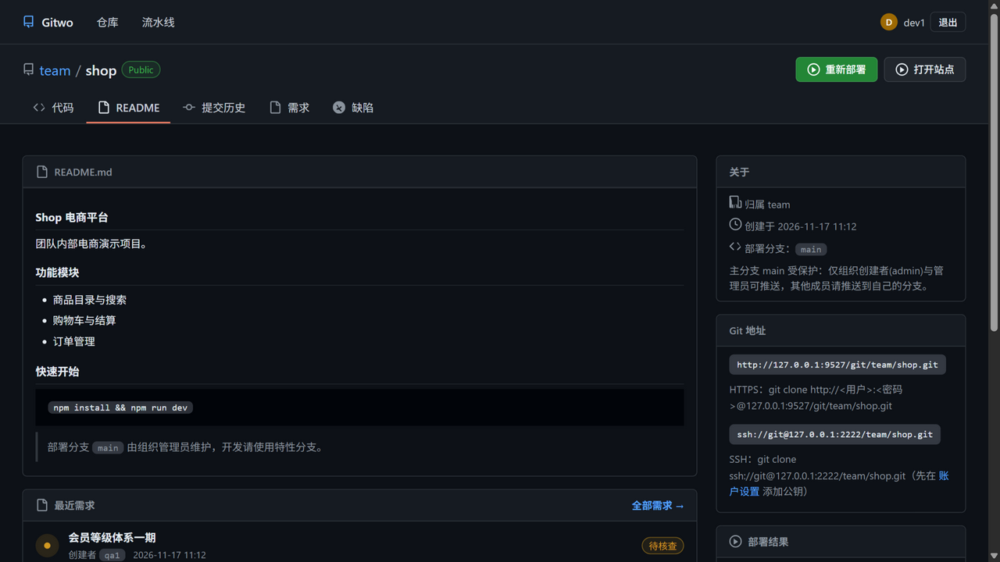
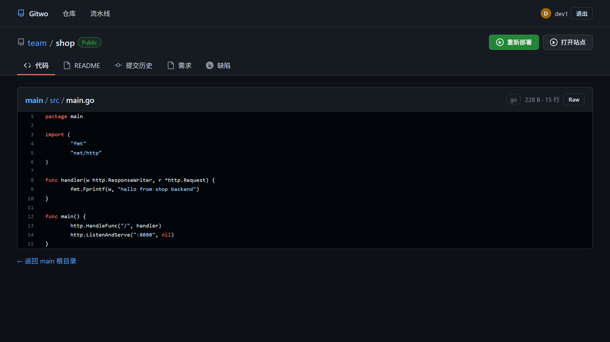
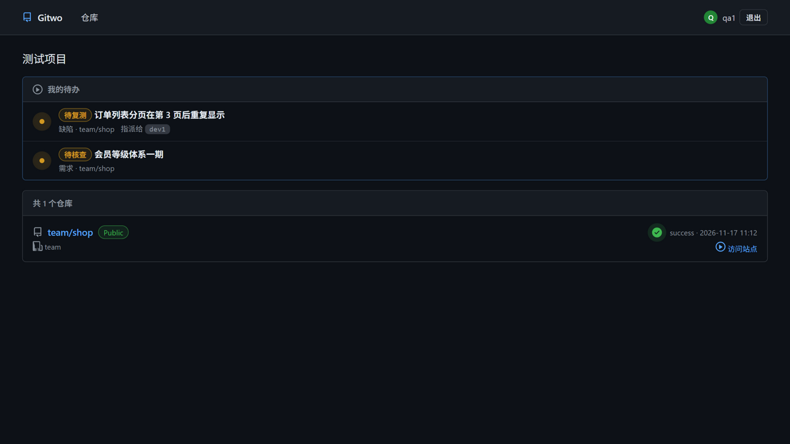
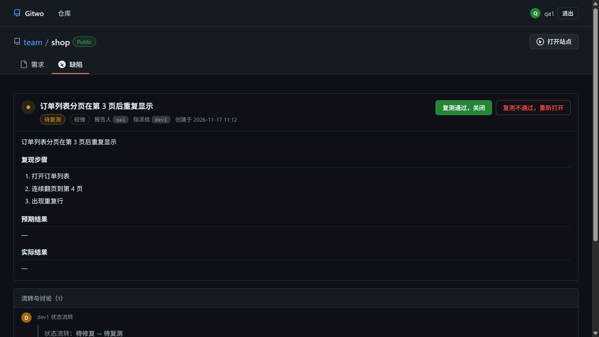
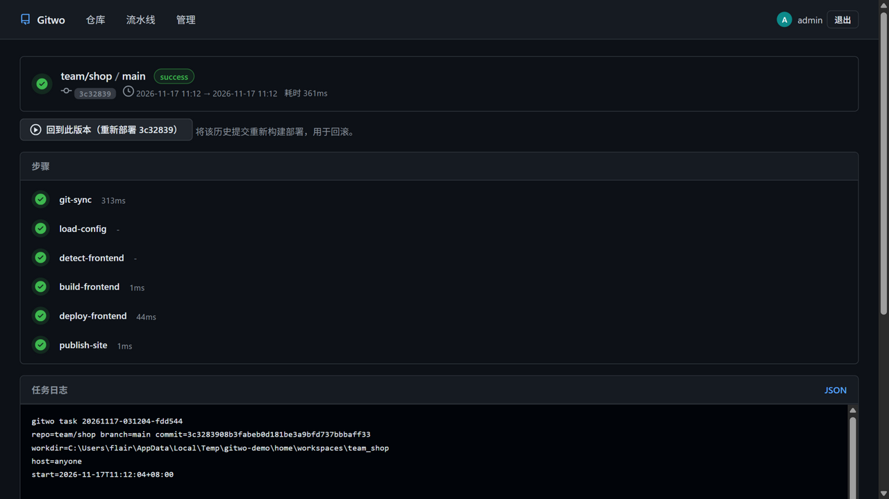
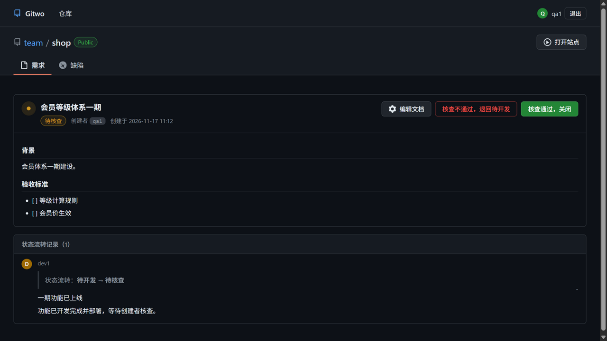

# Gitwo

自包含的**迷你 Git 服务端 + CI/CD 平台**：一个 Go 二进制，一个端口（默认 **9527**），提供 Git 托管、Web 管理界面、用户/组织权限、push 触发的构建流水线，以及部署站点的托管访问。

- ❌ 不用 Docker　❌ 不用 Nginx　❌ 不用数据库　❌ 不依赖 Gitea/GitLab
- ✅ 单二进制零配置启动；**程序所在目录即数据目录**；临时文件全部在 `/tmp/gitwo/`
- ✅ 内置 git 服务端（clone/push 走 HTTP 智能协议）
- ✅ push 后自动打包部署：静态站点、Go 服务（nohup + PID 管理）
- ✅ 流水线视图：实时看到每个构建步骤与日志
- ✅ 默认账户 `admin / admin`（登录后可改）；用户与组织权限
- ✅ 目标环境：**Ubuntu / CentOS Stream**

> **在线文档**：https://flairamos.github.io/gitwo/（界面截图与完整使用说明） · **完整截图集**：[docs/DEMO.md](docs/DEMO.md)

```
开发者 git push ──► Gitwo 内置 Git 服务端 (HTTP :9527)
                          │ 检测分支 ref 变化
                          ▼
                   部署队列（同仓库串行）
                          │
     git fetch+checkout ─► 读 deploy.yaml ─► 构建（npm/go/任意命令）
                          │
        ┌─────────────────┴──────────────────┐
        ▼                                    ▼
 静态站点 rsync 到 apps/<owner>_<repo>/static    二进制原子替换 + nohup 重启
        │                                    │
        ▼                                    ▼
 /sites/<repo>/ 托管访问               服务运行在自动分配端口（$PORT）
                          │
                          ▼
              流水线页面实时展示步骤与日志
```

## 界面速览

| 仓库概览（README 渲染 · HTTPS/SSH 双地址 · 主分支保护提示） | 代码浏览（浏览器端语法高亮 + 行号） |
|---|---|
|  |  |

| 测试角色「我的待办」（待复测缺陷 / 待核查需求一屏直达） | 缺陷流转（待修复 → 待复测 → 已关闭，附 md 文档与截图） |
|---|---|
|  |  |

| 流水线（push 自动构建部署，步骤耗时 + 实时日志） | 需求文档（标题平铺列表 → markdown 详情，仅创建者可编辑） |
|---|---|
|  |  |

> 需求文档、SSH 公钥管理、用户/组织管理、缺陷提交表单等完整截图见 [docs/DEMO.md](docs/DEMO.md)。

## 一分钟上手

```bash
# 任何有 Go 1.22+ 的机器
GOOS=linux GOARCH=amd64 go build -trimpath -ldflags "-s -w" -o gitwo-linux-amd64 .
# 拷到服务器后
sudo GITWO_BIN=gitwo-linux-amd64 ./scripts/install.sh
sudo systemctl enable --now gitwo
```

浏览器打开 `http://<服务器>:9527/`，用 **admin / admin** 登录（右上角立即改密）。

第一条部署流水线：

```bash
# 1. Web UI 上「新建仓库」→ 名字 demo
# 2. 本地：
git clone http://admin:<密码>@<服务器>:9527/git/admin/demo.git && cd demo
#    放入 index.html 与 deploy.yaml（examples/demo-static 是现成例子）
git add -A && git commit -m "first" && git push origin main
# 3. 打开 http://<服务器>:9527/pipelines 看构建流水线
# 4. 访问 http://<服务器>:9527/sites/admin_demo/（静态）或服务直连端口（service）
```

## 功能全景

| 模块 | 说明 |
|------|------|
| Git 服务端 | 智能 HTTP 协议（`git-upload-pack` / `git-receive-pack` 无状态 RPC），clone/push 均为 `http://host:9527/git/<归属>/<仓库名>.git`（归属 = 用户名或组织名）；支持协议 v2 |
| 受保护主分支 | **组织仓库的主分支（部署分支，缺省 main）仅组织创建者与管理员可推送/删除**，其他成员只能推送到自己的分支（推送时直接报错并提示）；实现为每个裸仓库的 pre-receive 钩子（启动/建仓时自动安装），用户仓库不受限 |
| SSH Git 服务 | 内嵌 SSH 服务端（默认 `:2222`，可配置/禁用），主机密钥首次启动自动生成；账户设置里添加 SSH 公钥（多把，SHA256 指纹展示）后即可 `git clone ssh://git@host:2222/<归属>/<仓库>.git`；同一 `git@` 身份按公钥指纹识别用户，多人各自加钥即可推送同一仓库（受保护主分支规则同样生效）；授权与 HTTPS 完全一致 |
| Web 管理界面 | 登录、仓库列表/创建/删除、仓库浏览（「代码」tab：任意分支/tag/提交快照的文件树，代码浏览器端语法高亮+行号——自包含 JS 无外部资源、raw、提交历史、README）、用户/组织管理、流水线页面；深色主题 |
| 账户体系 | 默认 admin/admin；PBKDF2-HMAC-SHA256 加盐哈希；会话 Cookie（HttpOnly + SameSite=Lax）；/me 自助改密；SSH 公钥管理（/me/keys，多把，指纹去重）；角色：管理员/开发者/测试 |
| 组织与权限 | 组织下挂用户并拥有仓库：组织成员可读写该组织全部仓库（多人共用、各自推送），组织间代码相互隔离；仓库可见性 private（登录）/public（匿名只读）；管理员全权；非成员 push 返回 403；组织仓库主分支受保护（仅创建者/管理员可推） |
| 流水线 | push 自动触发（或仓库页手动「重新部署」）；同仓库串行、跨仓库并行（workers）；每仓库排队上限；相同 commit 去重；任务状态 pending/running/success/failed/skipped；**回滚**：最近部署行 / 任务详情页一键「回到此版本」重新部署历史提交；**通知**：结束时可 POST 结果到配置的 webhook（notify_webhook）。**隔离**：仓库页只能进入该仓库自己的流水线（`/pipelines?repo=owner/name`，无全局入口）；全局流水线页只显示可读仓库的任务；任务详情/日志 API 校验仓库读权限（仓库删除后仅管理员可看历史） |
| 构建 | 仓库根 `deploy.yaml` 声明构建命令与产物；未知字段直接报错；注入 `GITWO_REPO/BRANCH/COMMIT/TASK/PORT` 与 `TMPDIR=/tmp/gitwo/tmp/<task>`；每步超时+进程组杀灭 |
| 静态部署 | `rsync -a --delete`（rsync 缺失时自动用内置 Go 同步）；发布到 `apps/<owner>_<repo>/static`，由平台托管在 `/sites/<repo>/`（SPA 回退可配） |
| 服务部署 | 二进制 temp+rename 原子替换（避开 text file busy）→ 读 `app.pid` → **/proc 校验 PID 归属防误杀** → SIGTERM 轮询 → 超时 SIGKILL → `nohup` 启动 → 2s 存活确认（死亡自动附 app.log 尾部）→ 端口保持稳定 |
| 端口管理 | `run.port` 显式指定，否则自动分配（20000-23999 可配）并注入 `$PORT`；下次部署沿用上次端口（站点地址不漂移）；启动前探测端口占用 |
| 站点托管 | `/sites/<repo>/`：静态目录直出或反代到服务端口；private 仓库需登录，public 匿名可访问 |
| API 代理 | `/api/<slug>/…` 反代到该仓库已部署的后端服务（127.0.0.1:$PORT），全 HTTP 方法可用——前后端共用 9527 一个端口，后端程序无需单独暴露端口或开防火墙；权限与站点一致（private 需登录） |
| 缺陷管理 | 仓库级缺陷单（严格隔离在所属仓库）：测试统一以 markdown 文档提交（复现步骤/预期结果/实际结果/备注，可附 ≤9 张截图），指派给指定开发人员；状态流转 **待修复 → 待复测 → 已关闭**，复测不通过退回待修复，误报可由提交人直接关闭；流转自动入档，测试/开发在缺陷页讨论（markdown）；被指派人只能是具有该仓库写权限的人员（测试角色不能被指派） |
| 需求管理 | 仓库级迭代需求文档（严格隔离在所属仓库）：任何可读者以 markdown 在线编写（浏览器直接编辑），**标题平铺**列表、点进详情看全文；**只有创建者可编辑内容**，其他人只读；状态流转 **待开发 → 待核查 → 已关闭**，有写权限者（代码提交者）提交核查，创建者验收通过后永久关闭（核查不通过可退回，作废可直接关闭）；流转自动入档；同组织任何角色可见 |
| 可观测 | `/pipelines` 实时刷新的流水线列表与详情（步骤耗时+实时日志）；任务日志归档 `/tmp/gitwo/logs/<repo>/`；`/api/status` JSON 概览 |
| 运维 | Gitwo 自身 systemd 常驻（`KillMode=process` 保护被部署服务）；优雅停机等运行中任务完成；Gitwo 重启不影响已部署服务（nohup 独立） |

## 目录布局

```
/opt/gitwo/                    程序目录 = 数据目录（-home 可覆盖，或 $GITWO_HOME）
├── gitwo                      二进制
├── repos/<owner>/<name>.git      裸 git 仓库（内置 git 服务端的数据）
├── workspaces/<owner>_<name>/    构建工作区（git checkout + 构建）
├── apps/<owner>_<name>/          部署产物：服务二进制、app.pid、app.log、
│                                 static/（前端）、backups/、.gitwo-site.json
└── data/                         users.yaml / orgs.yaml / repos.yaml /
                                  history.jsonl / server.yaml（可选）

/tmp/gitwo/                    临时文件（服务器重启清空，历史摘要不受影响）
├── logs/<repo>/<task>.log        任务日志（流水线页面实时读取）
└── tmp/<task>/                   构建临时目录（注入为构建的 TMPDIR）
```

`data/*.yaml` 文件格式为缩进 YAML、权限 600，可直接备份，也可手工编辑（改完重启）。

## deploy.yaml 规范

放在仓库根目录（或 `deploy.yml`）。三种类型：

| type | 用途 | 必填 |
|------|------|------|
| `static` | 纯前端站点 → `/sites/<repo>/` | `build.frontend` |
| `service` | Go 服务（可带前端）→ 服务直连端口 | `build.backend` + `run` |
| `dual` | 前端与 API 双产物（前端仍由平台托管） | `build.frontend` + `build.backend` + `run` |

完整字段与进阶示例见 [examples/](examples/)（`deploy-*-full.yaml`），最小例子在 `examples/demo`（service）与 `examples/demo-static`（static）。

要点：
- **构建型 vs 原生前端自动区分**：
  - `build.frontend.command` **有值** → 构建型（Vite/Vue/Webpack 等），执行构建后发布 `output`；
  - `command` **留空** → 原生静态目录，跳过构建直接发布 `output` 目录；
  - `type: static` 且**不写 build 段** → 零配置原生前端：仓库根目录即站点（需有 `index.html`），push 后直接发布；
  - 发布内容自动排除 `.git`、`deploy.yaml`，仓库元数据不会出现在站点里；
- `build.*.command` 在仓库根（或 `dir` 子目录）用 `sh -c` 执行，支持 `&&`、管道；
- `run.command` 的首词进程名用于 PID 归属校验（如 `./app` → 校验进程名 `app`）；
- 服务应读取 `$PORT` 监听（gitwo 自动分配并注入）；显式 `run.port` 则两处保持一致；
- 构建环境包含 `GITWO_REPO/BRANCH/COMMIT/TASK` 和 `TMPDIR`。

## 多语言构建与运行

**环境需提前预装**：Gitwo 不内置/不自动下载任何语言工具链——它只执行 `deploy.yaml` 里用户声明的命令，并透传服务器 PATH。环境没装时流水线会**明确报错**（错误信息附带命令输出尾部，如 `npm: not found`），不会误报成功。建议在服务器上统一预装（node 可用 nvm、java 用 JDK、go/python 官方包），Gitwo 以 systemd 运行时在 unit 的 `Environment=` 里补齐 PATH。

只要命令能写出来，就都能用——以下是主流组合的 `deploy.yaml` 片段（`...` 处按需补充）：

```yaml
# Java（javac/jar 构建，java -jar 运行）
type: service
build:
  backend:
    command: mvn -q package -DskipTests        # 或 javac && jar 自行打包
    output: target/app.jar
run:
  command: java -jar app.jar
  files: [config/application.yml]              # 运行所需的非二进制文件

# Python（解释运行；依赖用 venv + pip）
type: service
build:
  backend:
    command: python3 -m compileall -q app.py && echo ok > bin/build.stamp
    output: bin/build.stamp
run:
  command: ./venv/bin/python app.py            # 或 python3 app.py
  port: 18113
  files: [app.py]                              # 源码同步进运行目录

# 前端：vite / webpack / 任意构建器——只是命令不同
type: static
build:
  frontend:
    command: npm ci && npx webpack --mode production && cp index.html dist/
    output: dist
```

说明：
- `run.files`（可选）把仓库根的文件/目录同步进运行目录——解释型语言（python/node/java 多文件）必备，Go 单二进制不需要；
- 包装器命令（`npm start`、`mvn spring-boot:run`）也已支持：服务以独立进程组启动，停止时整组信号；Gitwo 会记录启动后的真实进程名（`app.name`）用于 PID 校验（兼容 `python3.14` vs `python3` 这类版本后缀）；
- 工具链版本由服务器决定（同一环境所有仓库共享）；需要按仓库多版本时用 nvm/sdkman/pyenv 并写进 `run.env` 或命令本身。

## 权限模型与角色

用户分三种角色（管理员在管理页创建用户时指定，可随时切换）：

| 能力 | 管理员 | 开发者 | 测试 |
|------|:------:|:------:|:----:|
| 查看可读仓库列表 / 访问已部署站点 | ✓ | ✓ | ✓ |
| 仓库测试视图（部署状态 + 「打开 Web 站点 / 后端服务」入口） | — | — | ✓ |
| 源码浏览（代码 tab / README / 提交历史 / 分支 / Git 地址） | ✓ | ✓ | ✗ |
| 缺陷管理（提交 / 复测关闭 / 讨论） | ✓ | ✓（被指派修复） | ✓（提交与复测） |
| 需求文档（查看 / 创建 / 编辑） | ✓ | ✓ | ✓（内容仅创建者可编辑；状态：有写权限者提交核查，创建者关闭） |
| git clone / push（含组织成员身份） | ✓ | ✓ | ✗ |
| 流水线列表 / 任务详情 / 构建日志 | ✓ | ✓ | ✗ |
| 触发部署 / 新建仓库 / 仓库设置 | ✓ | ✓（设置仅归属者） | ✗ |
| 用户 / 组织管理 | ✓ | ✗ | ✗ |

- **测试角色**为公司 QA 设计：只打开已部署的 Web 站点与后端服务做验证，接触不到源码、构建日志与部署操作；即便被加入组织也不获得写权限。
- 组织与角色正交：组织决定"能看到哪些仓库"，角色决定"能看到什么"。
- 匿名访问不受角色影响：public 仓库匿名只读（clone/查看/站点）。

| 谁 | 权限 |
|----|------|
| 管理员 | 一切：用户/组织管理、所有仓库读写与管理、已删除仓库的历史任务 |
| 开发者（仓库归属 / 组织成员） | 读写该仓库（push = 部署）、访问其站点 |
| 其他登录开发者 | 不可见 |
| 测试角色 | 可读仓库的站点与服务 + 测试视图；无源码/流水线/git |
| 匿名 | 仅 public 仓库：clone/查看/访问站点（只读） |

**组织规则**（管理 → 组织管理）：
- 组织下挂用户、组织拥有仓库；**同一组织的用户能看到并推送该组织管理的所有仓库**；
- 不同组织之间代码相互隔离：A 组织成员看不到 B 组织的 private 仓库；
- 可随时**新增组织**；**删除组织**要求组织下没有任何仓库（先把仓库删除或改归属），否则拒绝；
- 用户可以属于多个组织，看到的仓库是所属各组织仓库的并集；
- 旧版"群组"数据（groups.yaml、owner 前缀 `group:`）会在启动时自动迁移为组织。

> **安全须知**：`deploy.yaml` 的构建/启动命令直接以 gitwo 运行用户身份在宿主机执行——能 push 到仓库的人等同于拥有该用户级别的命令执行权限。请只把写权限授予可信成员，机器上不要用 root 跑 gitwo。

## HTTP 端点

| 端点 | 说明 |
|------|------|
| `GET /` | 仓库列表（仪表盘） |
| `GET|POST /login` `POST /logout` `GET|POST /me` | 登录/退出/改密 |
| `GET /me/keys` `POST /me/keys/add` `POST /me/keys/{id}/delete` | SSH 公钥管理 |
| `GET /repos/new` `POST /repos/new` | 新建仓库 |
| `GET /repos/{owner}/{name}` | 仓库首页（分支/部署状态/README/Git 地址） |
| `GET /repos/{owner}/{name}/tree/{branch}/{path...}` | 目录浏览（ref 可为分支名、tag 或提交 sha；分支切换下拉保留当前路径，路径不存在时回落分支根目录） |
| `GET /repos/{owner}/{name}/blob/{branch}/{path...}` | 文件内容（浏览器端语法高亮+行号，支持 Go/JS/TS/Python/Java/C/C++/Rust/Shell/SQL/YAML/JSON/TOML/HTML/CSS 等；≤512 KiB，二进制/超限提示用 raw） |
| `GET /repos/{owner}/{name}/raw/{branch}/{path...}` | 原始文件（≤64 MiB，带类型探测） |
| `GET /repos/{owner}/{name}/commits/{branch}` | 提交历史 |
| `GET|POST /repos/{owner}/{name}/settings` | 可见性/部署分支/删除（归属者或管理员） |
| `POST /repos/{owner}/{name}/deploy` | 手动部署；表单带 `sha` 时部署该历史提交（回滚） |
| `GET /pipelines[?repo={owner}/{name}]` `GET /pipelines/{id}` | 流水线列表/详情（实时日志；全局列表仅显示可读仓库，`?repo=` 为仓库作用域视图） |
| `GET /repos/{owner}/{name}/bugs[/new|/{id}]` 等 | 缺陷列表/提交/详情；`POST .../bugs/{id}/status` `POST .../bugs/{id}/comment` 状态流转与讨论；`GET .../bugs/{id}/files/{file}` 截图 |
| `GET /repos/{owner}/{name}/reqs[/new|/{id}[/edit]]` 等 | 需求文档列表（标题平铺）/创建/详情/编辑（仅创建者）；`POST .../reqs/{id}/status` 状态流转 |
| `GET /api/tasks/{id}/log` | 任务日志 JSON（详情页轮询此接口） |
| `GET /api/status` | 平台状态 JSON |
| `GET /sites/{owner_name}/{path...}` | 部署站点访问（`{owner_name}` = `归属_仓库名`） |
| `ANY /api/{owner_name}/[path…]` | 后端 API 代理（全 HTTP 方法；仅 type service/dual 且已部署的仓库） |
| `GET /git/{owner}/{repo}/info/refs`、`POST /git/{owner}/{repo}/git-{upload,receive}-pack` | git 智能协议（Basic 认证） |
| `GET /healthz` | 存活检查 |

## 配置（可选）

`data/server.yaml` 全部字段有默认值，见 [configs/server.yaml.example](configs/server.yaml.example)：监听地址（默认 `:9527`）、SSH Git 服务监听（默认 `:2222`，空串禁用）、workers、排队上限、verify_index、自动端口范围、各步骤超时。

## 生命周期行为

- Gitwo 重启：**不影响**已部署服务（nohup 进程独立，PID 文件仍在；下次部署用同一端口）。
- 服务器重启：Gitwo 由 systemd 拉起；已部署服务不自动恢复（设计取舍；如需自启可为业务服务另写 unit）。
- 任务日志在 `/tmp/gitwo/logs`，重启清空；`data/history.jsonl` 保留状态/耗时/错误摘要。

## 故障排查

| 现象 | 排查 |
|------|------|
| push 提示 Authentication failed | 账户/密码错误；URL 中的用户必须是平台用户（不是系统用户） |
| SSH 提示 Permission denied (publickey) | 公钥未在 账户设置→SSH 公钥 中登记；一把公钥只能绑定一个账户；测试角色无 git 权限 |
| push 提示 主分支受保护 | 组织仓库的主分支仅组织创建者/管理员可推送；请推送到自己的分支（git push origin HEAD:your-branch）并走合并/验收流程 |
| SSH 连上但 clone 失败 repository not found | 地址格式：ssh://git@host:2222/&lt;owner&gt;/&lt;repo&gt;.git；确认仓库归属名正确 |
| push 403 forbidden | 对 private 仓库无写权限（不是 owner/组织成员/管理员） |
| 启动报 未找到 git 可执行文件 | 平台依赖系统 git：安装 Git 或在 `data/server.yaml` 设置 `git_path`（或环境变量 `GITWO_GIT`）指向 git 绝对路径后重启；非标准安装目录必须显式指定 |
| 流水线失败：no deploy.yaml | 仓库根添加 deploy.yaml；或在仓库设置里确认部署分支 |
| 流水线失败：frontend output not found | 构建命令失败或 output 路径不对，看流水线日志的构建输出 |
| 流水线失败：index.html missing | 构建产物路径不对，或设 `verify_index: false` |
| 服务启动后立即失败 | 详情页日志自动附 `app.log` 尾部；多为端口/配置问题 |
| 服务地址打不开 | 确认服务读取了 `$PORT`；防火墙只需放行 9527（后端经 `/api/<slug>/` 代理访问，无需暴露 20000-23999） |
| `pid N currently runs "xxx", refusing to kill` | app.pid 指向了别的进程（PID 复用），人工清理 |
| git "dubious ownership" | 工作区曾被 root 触碰：`chown -R gitwo:gitwo <程序目录>` |
| SELinux / 防火墙 | install.sh 输出末尾有对应提示命令 |

日志：`journalctl -u gitwo -f`（平台自身）。

## 本地构建与启动

**Windows（PowerShell / cmd）：**

```powershell
go build -o gitwo.exe .
.\gitwo.exe serve                # http://127.0.0.1:9527，数据目录 = 二进制所在目录
.\gitwo.exe serve -home D:\gitwo-data   # 数据目录换到别处（repos/ apps/ data/ 都在里面）
```

**Linux / macOS：**

```bash
go build -o gitwo .
./gitwo serve                    # 数据目录 = 二进制所在目录
./gitwo serve -home /tmp/dp      # 指定数据目录
nohup ./gitwo serve -home ~/dp-smoke/home &   # 静默启动
```

- 首次启动自动创建默认账户 **admin / admin**（请立即登录改密），并自动生成 SSH 主机密钥
- SSH Git 服务默认监听 `:2222`，克隆地址 `ssh://git@<host>:2222/<owner>/<repo>.git`（需先在「账户设置 → SSH 公钥」添加公钥；`server.yaml` 里可改端口或禁用）

## 开发

```bash
go test ./...                      # 单测 + git 真实 push/clone 集成测试
go vet ./...
go build -o gitwo .                # 本地开发构建（Linux）
GOOS=linux go build -trimpath -ldflags "-s -w" -o gitwo-linux-amd64 .   # 交叉编译
```

版本注入：`-ldflags "-X gitwo/internal/version.Version=1.0.0"`。

## 设计取舍

- **git 协议直接对接系统 git 的 stateless-rpc**：协议兼容性由 git 自己保证，push 检测用 ref 前后快照对比，无需 hook 脚本。
- **nohup 托管业务进程**：脱离 Gitwo 独立存活、无僵尸进程、Gitwo 升级不中断业务；PID 文件 + /proc 校验避免复用误杀。
- **前端统一由平台托管**（`/sites/<repo>/`），不再为每个站点拉独立静态进程——一个端口全搞定。
- **rsync 优先、内置 Go 同步兜底**：保持单文件自包含，任何机器开箱即用。
- **数据全部是 YAML/文件**：无数据库，备份 = 拷目录。
