# Gitwo 功能演示

> 本文截图来自一套完整的演示环境：组织 `team`（成员 dev1 开发者 / qa1 测试）、仓库 `team/shop`（公开，含代码与部署站点）、缺陷三种状态、需求两种状态。启动方式见 [README「本地构建与启动」](../README.md#本地构建与启动)。

## 1. 登录

默认账户 `admin / admin`（首次登录后请立即改密）。会话 Cookie（HttpOnly + SameSite=Lax），密码以 PBKDF2-HMAC-SHA256 加盐存储。

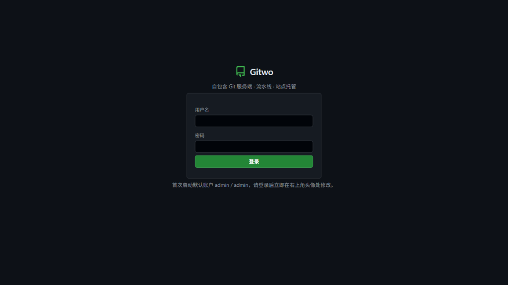

## 2. 测试角色仪表盘：我的待办

测试角色登录后只看到「测试项目」（无源码与流水线入口）。顶部「我的待办」聚合：**待复测的缺陷**（我提交的）、**待核查的需求**（我创建的）、指派给我的待修复缺陷——不用逐个仓库翻列表。

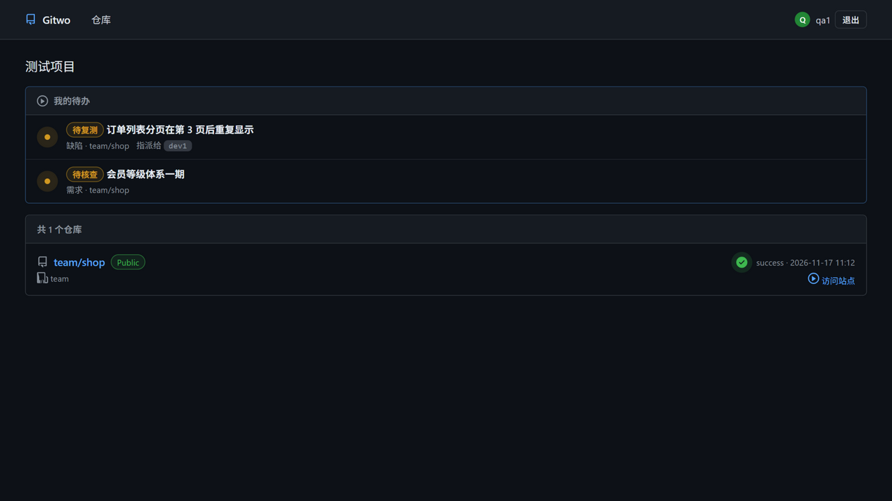

## 3. 仓库概览

README.md 以 **markdown 渲染**（标题/列表/代码块/引用）；右侧是 Git 地址（**HTTPS 与 SSH 双协议**）、部署结果与分支列表；组织仓库会提示**主分支保护规则**（仅组织创建者与管理员可直接推送）。

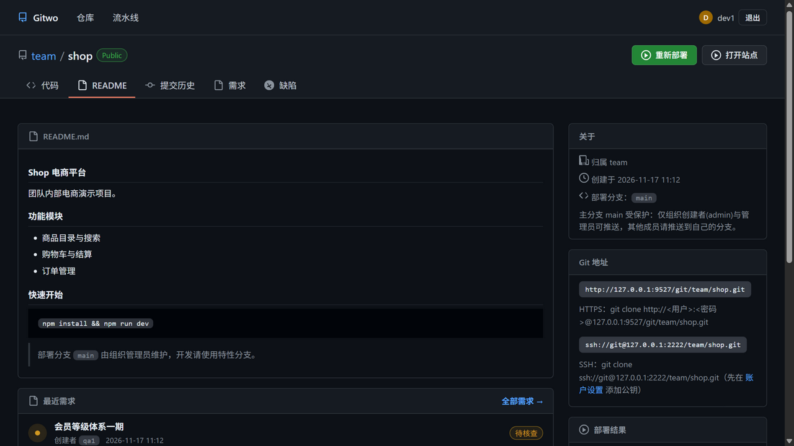

## 4. 代码浏览：目录树

「代码」tab 进入文件树：目录优先排序、文件大小、面包屑、分支下拉切换（切换时保留当前路径）、支持任意分支/tag/提交 sha。

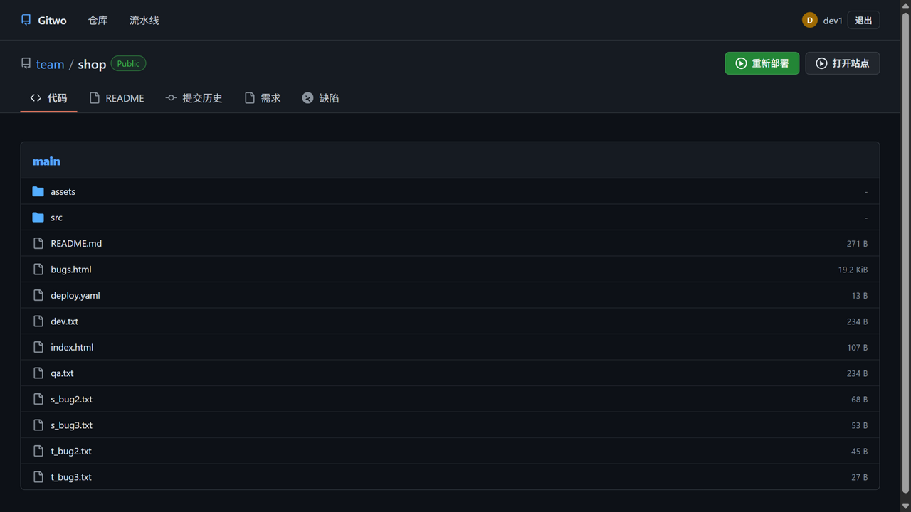

## 5. 代码浏览：语法高亮

点开文件即见**浏览器端语法高亮 + 行号**（自包含 JS 分词器，Go/JS/TS/Python/Java/C/C++/Rust/Shell/SQL/YAML 等，零外部资源）；右上角显示语言、大小、行数与 Raw 下载。

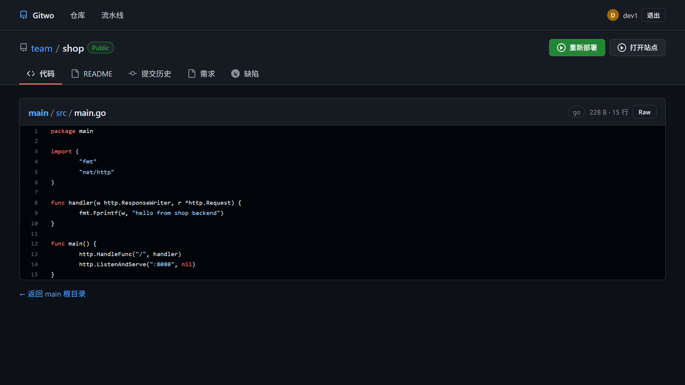

## 6. 提交历史

提交列表含作者与时间，每条短 SHA 可直接点击按该提交浏览代码快照。

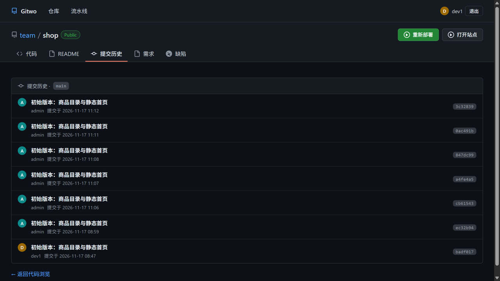

## 7. 缺陷管理

### 7.1 缺陷列表（三态）

列表展示 **待修复 / 待复测 / 已关闭** 三种状态与严重程度、报告人、指派人，可按状态过滤。缺陷严格隔离在所属仓库内。

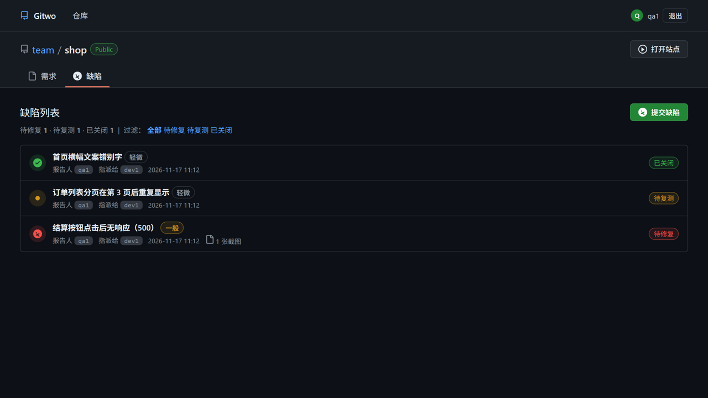

### 7.2 提交缺陷（统一 markdown 文档）

测试以标准表单提交：复现步骤 / 预期结果 / 实际结果 / 备注，自动组装为统一 markdown 文档；支持最多 9 张截图（png/jpeg/gif/webp）；指派对象仅限对该仓库有开发权限的人员（测试角色不可被指派）。

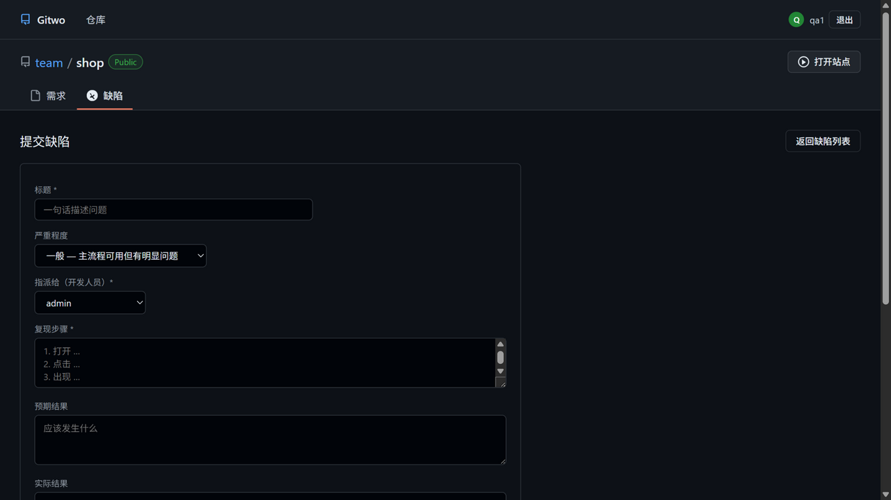

### 7.3 缺陷详情与流转

待复测状态下，报告人看到「复测通过，关闭」「复测不通过，重新打开」；开发修复后点「修复完成 → 待复测」。状态流转自动记录在讨论区（markdown 渲染）。

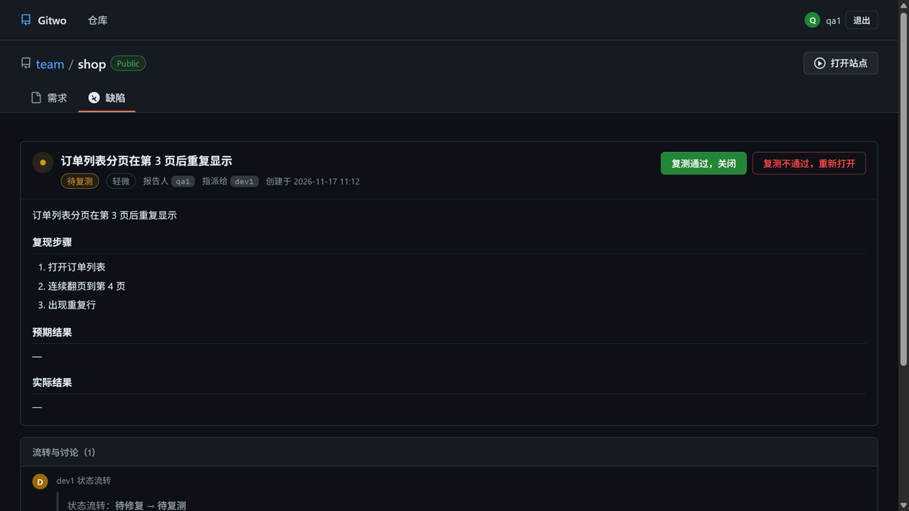

## 8. 需求管理

### 8.1 需求列表（标题平铺）

仓库级迭代需求文档：**标题平铺**列表 + 状态过滤（待开发 / 待核查 / 已关闭），同组织任何角色可见。

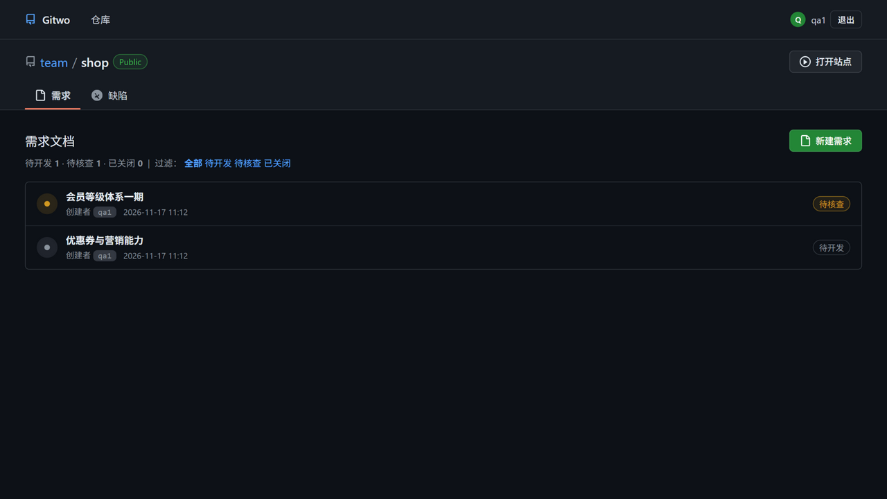

### 8.2 需求详情

markdown 在线文档；**只有创建者可编辑内容**，其他人只读；有写权限者（代码提交者）可将需求提交核查，创建者验收后关闭（核查不通过可退回、可作废直接关闭）。流转记录自动入档。

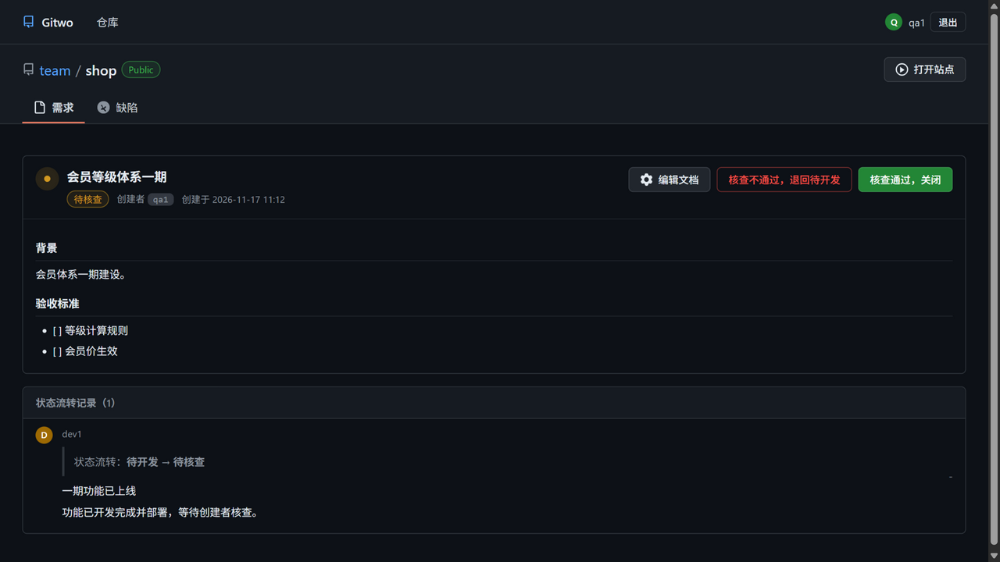

## 9. SSH 公钥管理

账户设置里保存多把 SSH 公钥（authorized_keys 单行粘贴，SHA256 指纹展示，一把钥匙只能绑定一个账户）。之后即可 `git clone ssh://git@<host>:2222/<owner>/<repo>.git`；多人各自加钥即可向同一组织仓库推送各自的分支。

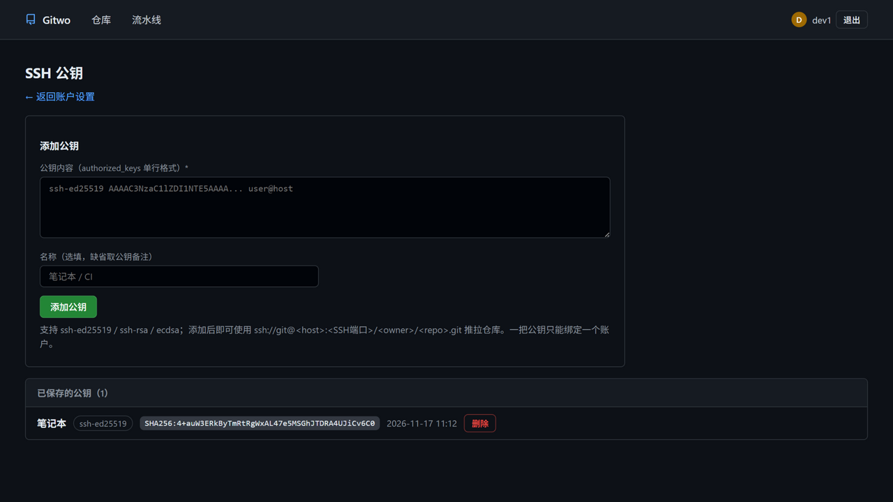

## 10. 流水线

push 自动触发（或手动/指定历史提交部署，支持回滚）。同仓库串行、跨仓库并行；列表实时刷新，任务详情展示每步耗时与构建日志，可配置 webhook 在结束时通知。

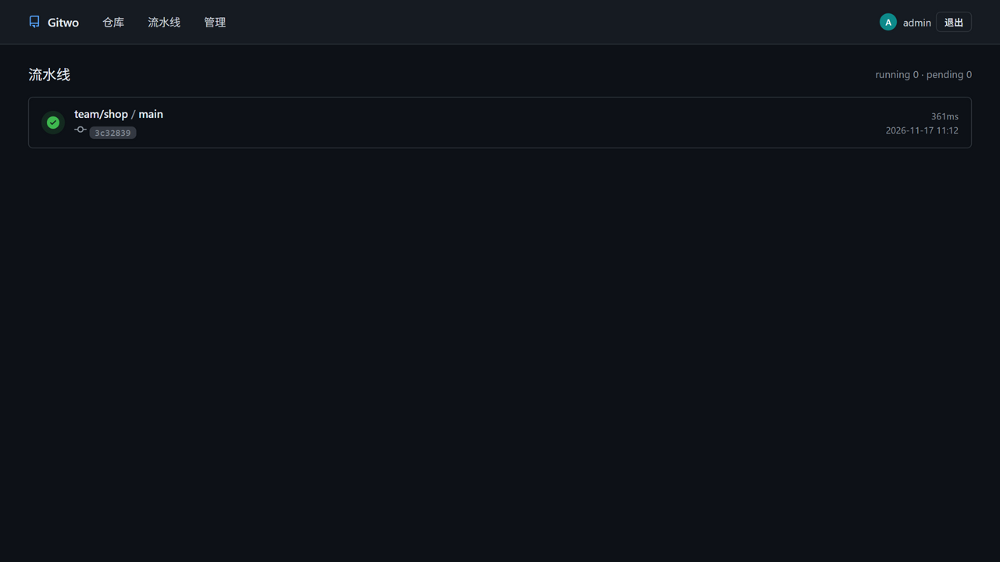

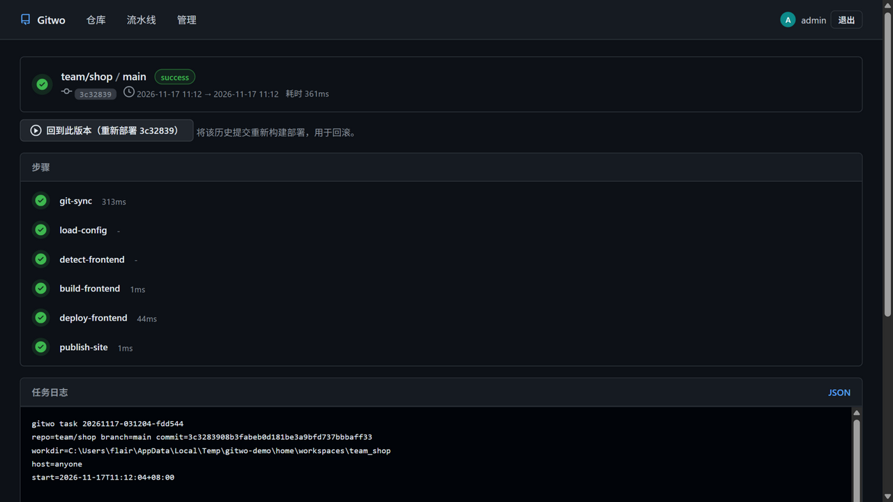

## 11. 用户与组织管理（管理员）

用户：管理员/开发者/测试三角色切换、重置密码、停用删除；组织：成员管理与仓库归属，删除组织前要求先清空仓库。

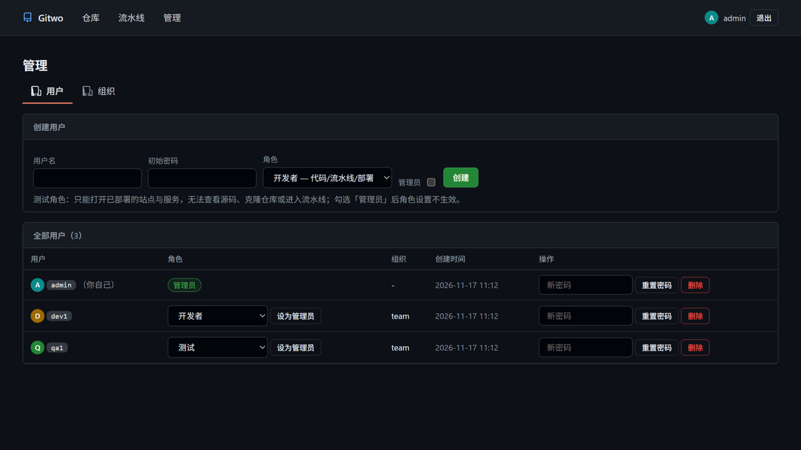

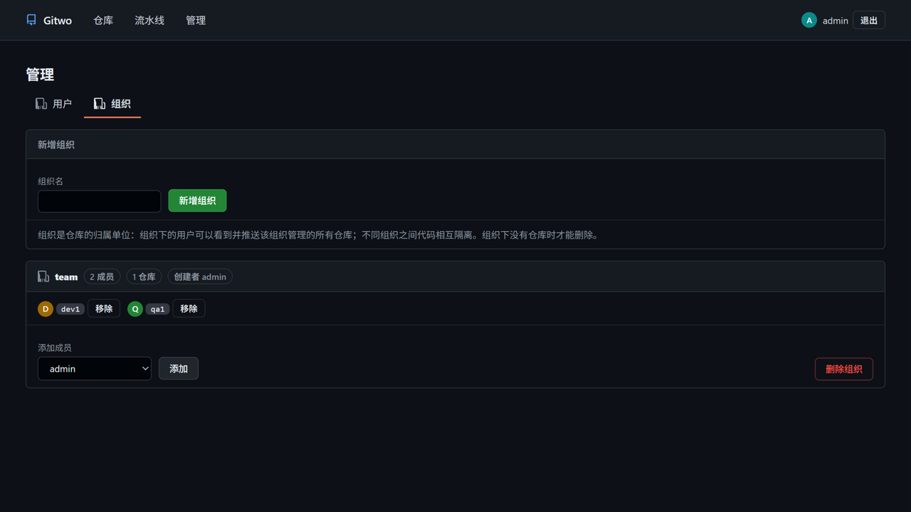

## 12. 站点托管

部署成功的静态前端由平台统一托管在 `/sites/<归属_仓库名>/`（静态直出，SPA 回退可配）；后端 API 经 `/api/<归属_仓库名>/…` 反代到服务端口——**前后端共用 9527 一个端口**，服务器只需暴露 9527（与 2222 SSH），无需为每个后端开放端口。


```bash
# 克隆与推送（HTTPS 输账户密码；SSH 用已登记的密钥）
git clone http://<host>:9527/git/team/shop.git
git clone ssh://git@<host>:2222/team/shop.git

# 后端 API 经代理访问（后端监听 $PORT 即可，不必对外暴露）
curl http://<host>:9527/api/team_shop/health
```
